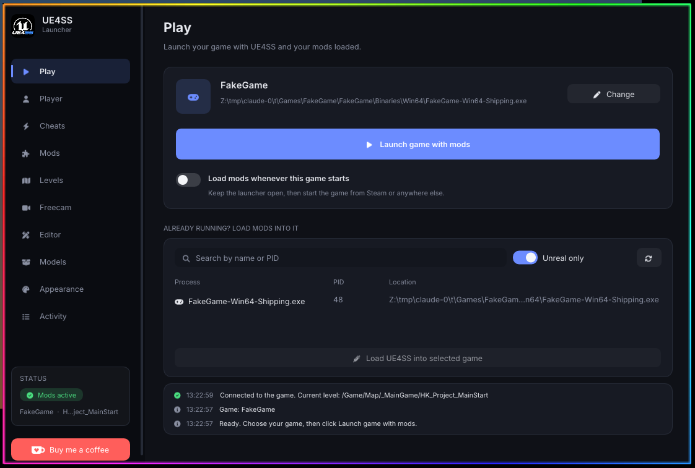
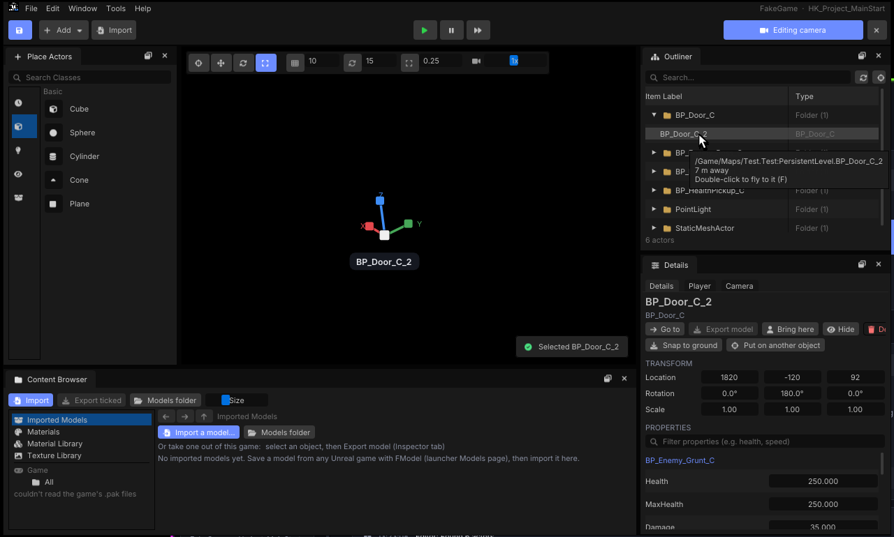

# UE4SS Launcher

A Windows launcher and **in-game editor** for single-player Unreal Engine games. Pick a game, press **Launch game with mods**, and you get mods, a free camera, cheats, a level browser and a full editor inside the running game. You can move, delete and add objects, and import your own 3D models.





> **Built on UE4SS.** The launcher loads [UE4SS (RE-UE4SS)](https://github.com/UE4SS-RE/RE-UE4SS) into the game to run its scripts. **Everything else (the launcher, the in-game editor, the freecam, the model import/export tools, the bridge mod and the game fixes) was created by me, [T0PGLitch3r](https://github.com/T0PGLitch3r).**

---

## What it does

### Launcher
- **Play.** Choose a game and launch it with UE4SS and your mods loaded. You can also load mods into a game that's already running, or have them load whenever the game starts (for example from Steam).
- **Game fixes.** It detects the game and sets up UE4SS for it automatically (signatures, layouts and settings). This includes fixes for games that crash or lag with stock UE4SS, such as High on Life, South of Midnight and Hogwarts Legacy.
- **Player.** Walk speed, jump height, gravity, god mode, ghost (no-clip), time scale and field of view.
- **Cheats.** Turns on the game's own cheat manager, and finds hidden debug menus and cheat managers that you normally can't open.
- **Mods.** Turn UE4SS mods on and off.
- **Levels.** Lists the game's maps, including test and dev levels, and loads them, skipping the ones that only show a black screen.
- **Freecam.** A free-flying editing camera. It stops the game's camera shakes, depth of field, motion blur and cursor from fighting it.
- **Models.** Import 3D models into any game, and export them out of games.
- **Appearance.** Themes, plus an optional animated RGB border around the window.
- **Activity.** A log of everything the launcher and the game mod did.
- An in-app file browser, so no Windows Explorer windows take over your mouse.

### In-game editor (press F2)
- An Unreal-Editor-style layout: **Place Actors**, **Outliner**, **Details**, **Content Browser** and a viewport with a move/rotate/scale gizmo, grid snapping and a yellow outline around whatever you select.
- Select anything in the level and move, rotate, scale, hide, delete or duplicate it. You can also fly to it, bring it to you, snap it to the ground or put it on top of another object.
- Edit an object's properties (health, speed, anything the game exposes) and its materials.
- Add basic shapes and lights, and spawn the game's own classes.
- Possess characters, play/pause/step the game, and undo.
- Your edits are saved per level and come back the next time you load it.

### Model tools
- **Import** `.glb`, `.gltf`, `.fbx`, `.obj` and FModel `.psk`/`.psa` models into the game you're playing. Textures, normal maps, roughness, glow and transparency come with them, and animations play.
- Models are built inside the game in a few seconds, even very detailed ones (millions of triangles). Big models are simplified down to the limit you set and get a light collision copy, so the game doesn't lag near them.
- **Export** any object from a game (Unreal 4 and 5 `.pak`/IoStore files, Oodle and AES-encrypted ones too) as **.glb** or **.fbx**, then import it into another game.
- Imported models belong to the game you imported them for. Each game has its own models folder.
- A material library and a texture library, so you can reuse looks across models.

### Dev build
`UE4SS-Launcher-Dev.exe` is the same launcher plus a Unity games page (MelonLoader / UnityExplorer).

---

## What we've done (recent work)

- **South of Midnight support:** a custom GUObjectArray signature, an editing camera that isn't thrown around by the game's cursor and post effects, and working test/dev level lists.
- **High on Life:** no longer crashes when you inject (UE4SS's LoadMap hook is turned off for it).
- **Hogwarts Legacy:** much less lag while the launcher is connected (fewer hooks, idle throttling).
- **Switching games** without restarting the launcher: models, thumbnails and the content browser reset to the new game.
- **Yellow selection outline** around the selected object, including games with unusual field-of-view settings.
- **Hidden debug menus and cheat managers:** the launcher finds them in the game's files and lets you open them.
- **High-detail imports:** up to 3 million triangles, with automatic simplification and a slider for the limit.
- **Export as .glb or .fbx**, and per-game imported models.
- **Big imports are fast:** simplification and texture saving run in parallel, and identical textures are saved once. A 2.2-million-triangle car went from never finishing to about 10 seconds.
- **Oodle-compressed games** (like Stray) now export models. The Oodle library is downloaded automatically when it's missing.
- **No lag near big imported models:** they collide with a light copy of their shape.
- **Animated RGB border** around the launcher.

---

## Building

You need MinGW-w64 (`x86_64-w64-mingw32-g++`) on Linux, WSL or MSYS2.

```bash
./build.sh
```

The script downloads Dear ImGui into `./imgui` the first time, then builds `UE4SS-Launcher.exe` and `UE4SS-Launcher-Dev.exe`. The UE4SS files in `bundle/` and the fonts and icons in `res/` are packed into the exe, so it runs on its own.

## Credits

- **[UE4SS / RE-UE4SS](https://github.com/UE4SS-RE/RE-UE4SS)** (MIT) runs the scripts inside the game. Its DLL, default mods and licence are in `bundle/`.
- Open-source libraries included under their own licences:
  - [Dear ImGui](https://github.com/ocornut/imgui) (MIT)
  - [meshoptimizer](https://github.com/zeux/meshoptimizer) (MIT)
  - [ufbx](https://github.com/ufbx/ufbx) (MIT)
  - [cgltf](https://github.com/jkuhlmann/cgltf) (MIT)
  - [stb_image / stb_image_write](https://github.com/nothings/stb) (MIT / public domain)
  - [ACL](https://github.com/nfrechette/acl) and [RTM](https://github.com/nfrechette/rtm) (MIT)
  - puff (zlib licence)
  - [Inter](https://rsms.me/inter/) and [Font Awesome Free](https://fontawesome.com/) fonts (SIL OFL)
- Oodle decompression uses Epic's Oodle library from [WorkingRobot/OodleUE](https://github.com/WorkingRobot/OodleUE), downloaded at runtime (not included here).

All other code is mine.

## Support

If you like it, you can buy me a coffee: **[ko-fi.com/glitch3r](https://ko-fi.com/glitch3r)** ☕

*For single-player games only. Don't use it in online or multiplayer games.*
